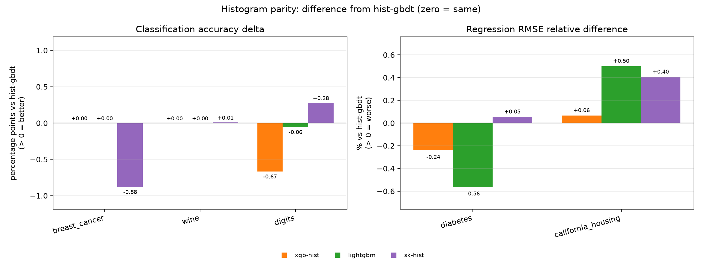
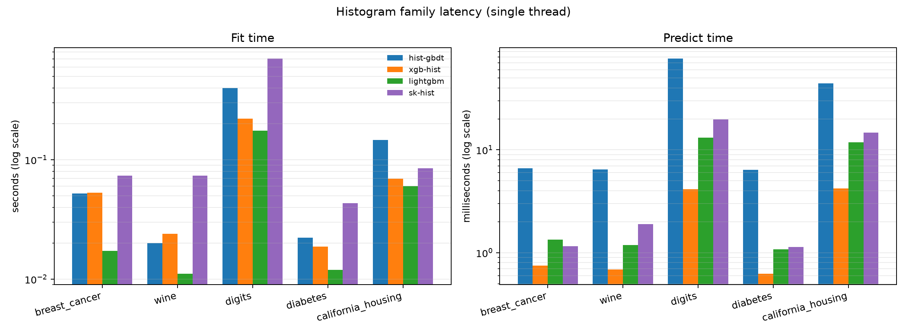
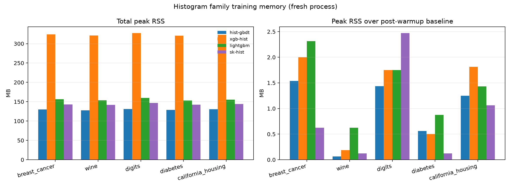
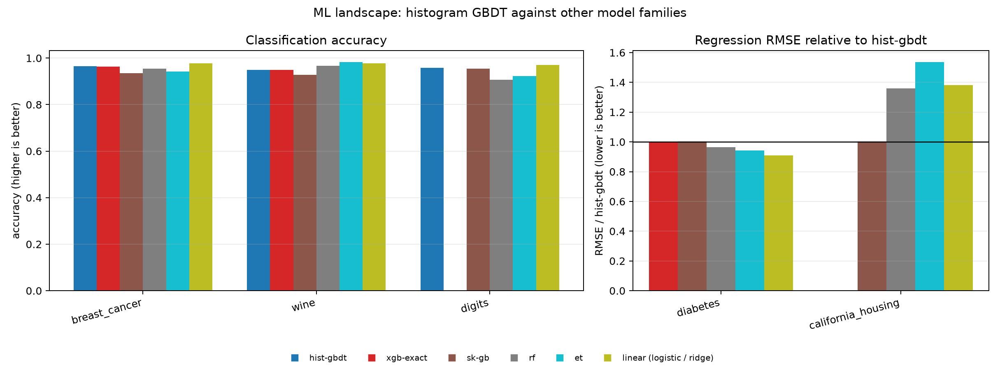
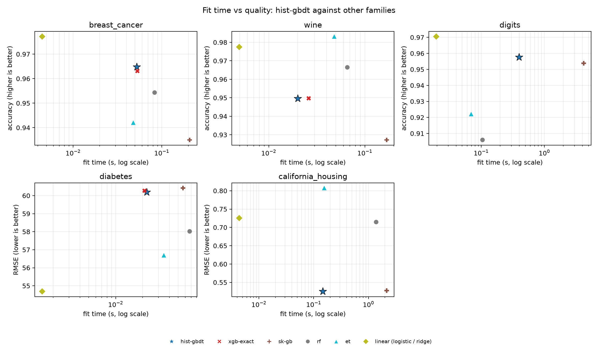

# Real-data benchmark

- This is a learning benchmark, not a tuned leaderboard.
- Machine: AMD Ryzen 7 7735HS with Radeon Graphics
- Python 3.14.7, NumPy 2.5.4, scikit-learn 1.9.1
- hist-gbdt 0.1.0, XGBoost 3.4.1, LightGBM 4.6.0
- 3-fold CV, 60 trees, depth 4, learning rate 0.1, max_bin 256, n_jobs=1
- Same folds and nominal tree budget for every model; one warmup call per model; no early stopping.

## Datasets

| dataset | task | n | k | classes |
|---|---|---:|---:|---:|
| breast_cancer | classification | 569 | 30 | 2 |
| wine | classification | 178 | 13 | 3 |
| digits | classification | 1797 | 64 | 10 |
| diabetes | regression | 442 | 10 | — |
| california_housing | regression | 20640 | 8 | — |

### breast_cancer (classification, n=569, k=30, classes=2)

| model | accuracy | macro-F1 | logloss | AUC | fit (s) | predict (ms) |
|---|---:|---:|---:|---:|---:|---:|
| logistic | 0.9772 ± 0.009 | 0.9754 ± 0.010 | 0.0735 ± 0.018 | 0.9955 ± 0.004 | 0.0045 | 0.49 |
| xgb-hist | 0.9649 ± 0.012 | 0.9625 ± 0.013 | 0.1139 ± 0.034 | 0.9902 ± 0.005 | 0.0530 | 0.75 |
| lightgbm | 0.9649 ± 0.009 | 0.9624 ± 0.009 | 0.1168 ± 0.036 | 0.9909 ± 0.005 | 0.0172 | 1.34 |
| hist-gbdt | 0.9649 ± 0.009 | 0.9624 ± 0.009 | 0.1103 ± 0.030 | 0.9914 ± 0.003 | 0.0523 | 6.61 |
| xgb-exact | 0.9631 ± 0.007 | 0.9604 ± 0.007 | 0.1151 ± 0.037 | 0.9919 ± 0.005 | 0.0531 | 0.72 |
| sk-hist | 0.9561 ± 0.015 | 0.9532 ± 0.016 | 0.1280 ± 0.041 | 0.9902 ± 0.003 | 0.0738 | 1.15 |
| rf | 0.9543 ± 0.009 | 0.9509 ± 0.009 | 0.1356 ± 0.013 | 0.9905 ± 0.004 | 0.0831 | 4.70 |
| et | 0.9420 ± 0.013 | 0.9365 ± 0.015 | 0.1951 ± 0.005 | 0.9917 ± 0.005 | 0.0477 | 4.86 |
| sk-gb | 0.9350 ± 0.029 | 0.9306 ± 0.029 | 0.2560 ± 0.192 | 0.9764 ± 0.019 | 0.2066 | 0.58 |

### wine (classification, n=178, k=13, classes=3)

| model | accuracy | macro-F1 | logloss | AUC | fit (s) | predict (ms) |
|---|---:|---:|---:|---:|---:|---:|
| et | 0.9831 ± 0.014 | 0.9839 ± 0.013 | 0.3356 ± 0.007 | — | 0.0480 | 4.66 |
| logistic | 0.9775 ± 0.008 | 0.9781 ± 0.008 | 0.0660 ± 0.000 | — | 0.0049 | 0.41 |
| rf | 0.9665 ± 0.027 | 0.9675 ± 0.026 | 0.1710 ± 0.014 | — | 0.0657 | 4.54 |
| sk-hist | 0.9497 ± 0.036 | 0.9519 ± 0.034 | 0.1393 ± 0.100 | — | 0.0734 | 1.89 |
| xgb-exact | 0.9497 ± 0.041 | 0.9517 ± 0.039 | 0.1375 ± 0.057 | — | 0.0261 | 0.71 |
| hist-gbdt | 0.9496 ± 0.036 | 0.9512 ± 0.035 | 0.1187 ± 0.037 | — | 0.0200 | 6.47 |
| xgb-hist | 0.9496 ± 0.036 | 0.9514 ± 0.035 | 0.1336 ± 0.054 | — | 0.0240 | 0.68 |
| lightgbm | 0.9496 ± 0.036 | 0.9514 ± 0.035 | 0.1301 ± 0.046 | — | 0.0111 | 1.18 |
| sk-gb | 0.9272 ± 0.031 | 0.9298 ± 0.029 | 0.3073 ± 0.099 | — | 0.1688 | 0.94 |

### digits (classification, n=1797, k=64, classes=10)

| model | accuracy | macro-F1 | logloss | AUC | fit (s) | predict (ms) |
|---|---:|---:|---:|---:|---:|---:|
| logistic | 0.9705 ± 0.005 | 0.9705 ± 0.005 | 0.1036 ± 0.012 | — | 0.0194 | 0.71 |
| sk-hist | 0.9605 ± 0.003 | 0.9605 ± 0.003 | 0.1394 ± 0.002 | — | 0.7066 | 19.70 |
| hist-gbdt | 0.9577 ± 0.003 | 0.9577 ± 0.003 | 0.1455 ± 0.003 | — | 0.3988 | 77.28 |
| lightgbm | 0.9572 ± 0.001 | 0.9570 ± 0.001 | 0.1475 ± 0.001 | — | 0.1753 | 13.08 |
| sk-gb | 0.9538 ± 0.004 | 0.9538 ± 0.004 | 0.1517 ± 0.007 | — | 4.2058 | 9.06 |
| xgb-hist | 0.9510 ± 0.003 | 0.9512 ± 0.003 | 0.1863 ± 0.000 | — | 0.2212 | 4.16 |
| et | 0.9221 ± 0.008 | 0.9210 ± 0.009 | 1.0591 ± 0.012 | — | 0.0694 | 6.26 |
| rf | 0.9060 ± 0.008 | 0.9048 ± 0.007 | 0.9088 ± 0.003 | — | 0.1049 | 6.08 |

### diabetes (regression, n=442, k=10)

| model | RMSE | MAE | R² | fit (s) | predict (ms) |
|---|---:|---:|---:|---:|---:|
| ridge | 54.6891 ± 0.894 | 44.1265 ± 0.477 | 0.4900 ± 0.062 | 0.0015 | 0.33 |
| et | 56.6917 ± 2.418 | 47.1414 ± 2.426 | 0.4544 ± 0.050 | 0.0346 | 4.98 |
| rf | 58.0188 ± 2.452 | 46.9434 ± 1.706 | 0.4276 ± 0.062 | 0.0672 | 4.81 |
| lightgbm | 59.8554 ± 3.564 | 48.2383 ± 2.709 | 0.3917 ± 0.065 | 0.0120 | 1.08 |
| xgb-hist | 60.0499 ± 3.453 | 48.2340 ± 2.691 | 0.3873 ± 0.069 | 0.0187 | 0.62 |
| hist-gbdt | 60.1940 ± 3.435 | 48.4405 ± 2.560 | 0.3840 ± 0.072 | 0.0222 | 6.39 |
| sk-hist | 60.2261 ± 3.440 | 48.4752 ± 2.661 | 0.3834 ± 0.072 | 0.0433 | 1.13 |
| xgb-exact | 60.2725 ± 3.318 | 48.3400 ± 2.339 | 0.3825 ± 0.071 | 0.0210 | 0.61 |
| sk-gb | 60.4214 ± 3.506 | 48.8386 ± 2.820 | 0.3786 ± 0.080 | 0.0567 | 0.56 |

### california_housing (regression, n=20640, k=8)

| model | RMSE | MAE | R² | fit (s) | predict (ms) |
|---|---:|---:|---:|---:|---:|
| hist-gbdt | 0.5254 ± 0.005 | 0.3618 ± 0.002 | 0.7926 ± 0.005 | 0.1462 | 44.43 |
| xgb-hist | 0.5257 ± 0.006 | 0.3624 ± 0.003 | 0.7924 ± 0.005 | 0.0695 | 4.20 |
| sk-hist | 0.5275 ± 0.004 | 0.3631 ± 0.002 | 0.7909 ± 0.005 | 0.0848 | 14.64 |
| sk-gb | 0.5277 ± 0.004 | 0.3639 ± 0.003 | 0.7908 ± 0.005 | 2.1550 | 5.94 |
| lightgbm | 0.5280 ± 0.006 | 0.3646 ± 0.003 | 0.7905 ± 0.005 | 0.0603 | 11.82 |
| rf | 0.7146 ± 0.013 | 0.5272 ± 0.007 | 0.6163 ± 0.012 | 1.3832 | 14.42 |
| ridge | 0.7255 ± 0.009 | 0.5314 ± 0.004 | 0.6047 ± 0.006 | 0.0044 | 0.71 |
| et | 0.8074 ± 0.006 | 0.6083 ± 0.001 | 0.5103 ± 0.005 | 0.1559 | 11.98 |

## Figures

The same saved CSV is shown through two lenses: a like-for-like histogram
comparison and a broader model-family landscape.

### Histogram parity

### ML landscape

## Reading the numbers honestly

- The linear baselines are strongest on the small tabular datasets (`breast_cancer`, `wine`, `digits`, `diabetes`). This is expected: the sample count is small, the signal is close to linear, and the tree models are deliberately not tuned.
- On `california_housing`, `hist-gbdt` is competitive with XGBoost and LightGBM in RMSE, but it is slower to fit than both.
- Prediction is still pure Python tree traversal. Multiclass prediction on `digits` is therefore much slower than the libraries even when fit time is comparable.
- XGBoost Exact is only run when `n_samples <= 2000` and `n_features <= 32`; it is the older exact-greedy split strategy, not an old XGBoost package version.
- The real datasets here have no missing values. Missing-value handling is exercised by the synthetic and parity tests, not by this table.
- Treat sub-millisecond differences as noise. Treat the real-data result as a sanity check on engineering, not a claim of state-of-the-art accuracy.

Raw rows: `129`; aggregate rows: `43`.
